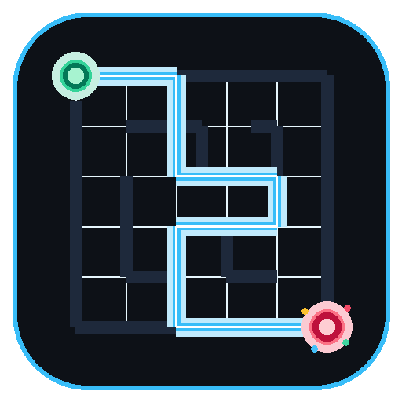

<p align="center">
  
</p>

<h1 align="center">🧩 MAZESolver</h1>

<p align="center">
  <b>An interactive AI search algorithm visualizer and pathfinding benchmark suite in Python.</b><br />
  Featuring BFS, DFS, DLS, IDDFS, and A* heuristic search, real-time wavefront heatmaps, procedural maze generators, split-screen multi-algorithm races, and a standalone Windows desktop executable.
</p>

<p align="center">
  <a href="https://github.com/HaxOrWot/MAZESolver/releases/latest"></a>
  
  
  
  
  <a href="LICENSE"></a>
</p>

<p align="center">
  <a href="#-super-short-commands-fast-start">⚡ Fast Start</a> •
  <a href="#-standalone-desktop-app-mazesolverexe">💻 Desktop App</a> •
  <a href="#-supported-algorithms">🤖 Algorithms</a> •
  <a href="#-key-features">✨ Features</a> •
  <a href="#-visualizer-controls--hotkeys">🎮 Controls</a> •
  <a href="#-benchmarks">📊 Benchmarks</a> •
  <a href="#-author--contributors">🤝 Contributors</a>
</p>

---

## ⚡ Super Short Commands (Fast Start)

No need to write long paths or verbose parameters! Use the fast command wrappers `.\maze` (PowerShell/CMD) or `python run.py`:

| What you want to do | Short Command (Windows) | Cross-Platform |
|---|---|---|
| 🚀 **Launch Desktop Hub** | `.\maze` | `python run.py` |
| 📊 **Run 5-Way Benchmark Matrix** | `.\maze -c` | `python run.py -c` |
| 🖥️ **Split-Screen Race (3 Algorithms)** | `.\maze -s` | `python run.py -s` |
| ✏️ **Interactive Maze Drawing Canvas** | `.\maze -e` | `python run.py -e` |
| 🔍 **Solve 50×50 Maze with Default BFS** | `.\maze 50` | `python run.py 50` |
| 🌟 **Solve 100×100 with A\* Heuristic** | `.\maze 100 astar` | `python run.py 100 astar` |
| 🎨 **Neon Cyberpunk Theme** | `.\maze 20 -t neon` | `python run.py 20 -t neon` |
| 🎞️ **Export Full Solve as Animated GIF** | `.\maze 10 --export-gif` | `python run.py 10 --export-gif` |
| 🏗️ **Generate Solvable 35×35 Grid** | `.\maze -g --maze-size 35` | `python run.py -g --maze-size 35` |

---

## 🔤 Short Flags Reference

Combine flags freely to customize any execution:

| Flag | Long Option | Description & Usage Example |
|---|---|---|
| `-m` | `--maze` | Maze name or size: `-m 50` or `-m data/maze_50x50.txt` |
| `-a` | `--algo` | Algorithm choice: `bfs`, `dfs`, `dls`, `iddfs`, `astar` |
| `-v` | `--visual` | Open the animated step-by-step visualizer |
| `-c` | `--compare` | Run side-by-side terminal comparison table across all 5 algorithms |
| `-s` | `--splitview` | Launch synchronous 3-panel side-by-side race (BFS vs DFS vs DLS) |
| `-e` | `--edit` | Open the interactive grid drawing and testing editor |
| `-t` | `--theme` | Visual theme: `dark`, `neon`, `retro`, `light` |
| `-g` | `--generate` | Procedurally generate a new maze before solving |
| `-l` | `--limit` | Custom depth cutoff threshold for DLS (e.g. `-l 45`) |
| `--export-gif`| — | Render headless solve and encode directly to looping GIF |

```powershell
# Examples:
python src/main.py -m 40 -a astar -v
python src/main.py -m 100 -c
python src/main.py -m 30 -s -t neon
python src/main.py -e
```

---

## 💻 Standalone Desktop App (`MAZESolver.exe`)

MAZESolver is available as a **standalone native Windows executable** with **zero Python setup required**.

<p align="center">
  <b>Binary location:</b> <code>src\App\MAZESolver.exe</code> &nbsp;•&nbsp; 
  <a href="https://github.com/HaxOrWot/MAZESolver/releases/latest"><b>Download from Latest GitHub Release ↗</b></a>
</p>

### 1. Interactive Desktop Hub (Double-Click)
Simply **double-click `MAZESolver.exe`** in Windows Explorer to open the GUI Control Hub:
- **Execution Modes:** One-click toggles between Visual Solver, Split-Screen Comparison, 5-Way Benchmark, and Maze Editor.
- **Maze Archive:** Choose from pre-generated sizes (`5×5` up to `100×100`) or procedural generation with live thumbnail inspection.
- **Algorithm & Theme Selectors:** BFS, DFS, DLS, IDDFS, A* Heuristic; Dark, Neon, Retro CRT, Paper Light.
- **Real-Time Parameters:** Animation speed presets, audio toggle, and DLS bounded stepper.
- Click **🚀 START VISUAL SOLVER** or hit `Space`/`Enter` to run.

### 2. Command-Line Support via EXE
`MAZESolver.exe` also accepts all standard CLI flags:
```powershell
.\src\App\MAZESolver.exe -c
.\src\App\MAZESolver.exe 50 astar -v
.\src\App\MAZESolver.exe -s -t neon
```

### 3. Rebuilding the Executable
If you modify source code, rebuild the standalone `.exe` with one command:
```powershell
python src/App/build_exe.py
```

---

## 🤖 Supported Algorithms

MAZESolver implements both **Uninformed (Blind)** and **Informed (Heuristic)** search algorithms with cycle prevention:

| Algorithm | Category | Frontier Data Structure | Optimal? | Complete? | Time Complexity | Space Complexity |
|---|---|---|:---:|:---:|---|---|
| **BFS** (Breadth-First Search) | Uninformed | Queue (FIFO) | ✅ Yes | ✅ Yes | $\mathcal{O}(V + E)$ | $\mathcal{O}(V)$ |
| **DFS** (Depth-First Search) | Uninformed | Stack (LIFO) | ❌ No | ✅ Yes* | $\mathcal{O}(V + E)$ | $\mathcal{O}(d)$ |
| **DLS** (Depth-Limited Search) | Bounded | Stack + Depth Bound | ❌ No | ❌ No | $\mathcal{O}(b^L)$ | $\mathcal{O}(L)$ |
| **IDDFS** (Iterative Deepening) | Uninformed | Iterative Stack | ✅ Yes | ✅ Yes | $\mathcal{O}(b^d)$ | $\mathcal{O}(d)$ |
| **A\*** (Heuristic Pathfinding) | Informed | Min-Heap Priority Queue | ✅ Yes | ✅ Yes | $\mathcal{O}((V + E)\log V)$ | $\mathcal{O}(V)$ |

*\*On finite, loop-checked graphs with visited hashing.*

---

## ✨ Key Features

- 🌈 **Exploration Heatmap Wavefront:** Visited cells transition smoothly along a dynamic thermal gradient (cold cyan/blue to hot magenta/orange) based on exploration step order.
- 🎨 **4 Dynamic Color Themes:** Switch on the fly (`T` key) between `Dark` (Obsidian), `Neon` (Cyberpunk), `Retro` (Phosphor CRT), and `Light` (Minimal Paper).
- 📊 **Multi-Tab HUD Inspector:** 
  - `[1]` **Live Performance:** Real-time explored count, path length, time elapsed, and grid coverage percentage.
  - `[2]` **Frontier Inspector:** Live snapshot of the top 8 nodes currently pending in the frontier queue/stack.
  - `[3]` **Algorithm Explainer:** In-window reference of algorithm theory, optimality, and time/space characteristics.
- 🖥️ **Split-Screen Comparison Race (`-s`):** Run BFS, DFS, and DLS synchronously in a 3-panel view with uniform layout and comparative bottom telemetry.
- 🏗️ **Procedural Maze Generator (`-g`):** Generate solvable mazes via **Recursive Backtracking** or **Randomized Prim's Algorithm**.
- ✏️ **Interactive Maze Editor (`-e`):** Draw and carve custom mazes with mouse dragging, place Start/Goal anchors, test BFS/DFS/A* path previews in real-time, and save directly to `.txt`.
- 🎆 **Particle Physics Burst:** Celebratory particle physics burst from the goal anchor upon solution completion.
- 🎞️ **Looping GIF & Screenshot Export:** Record headless animated solves directly into looping `.gif` files (`--export-gif` / `G` key) or capture hi-res `.png` snapshots (`S` key).
- 🔊 **Audio FX Synthesizer:** Real-time frequency-modulated exploration ticks and triumphant goal fanfare chords (toggle mute with `M`).

---

## 📁 Included Mazes (`data/`)

The repository includes guaranteed-solvable grids ready to test:

| Maze File | Dimensions | Difficulty / Purpose |
|---|---|---|
| `maze_5x5.txt` | 5 × 5 | Micro validation & step-through |
| `maze_10x10.txt` | 10 × 10 | Quick demo |
| `maze_20x20.txt` | 20 × 20 | Standard benchmark testbed |
| `maze_30x30.txt` | 30 × 30 | Medium branching |
| `maze_40x40.txt` | 40 × 40 | Deep labyrinth pathways |
| `maze_50x50.txt` | 50 × 50 | High-density path exploration |
| `maze_60x60.txt` | 60 × 60 | Extended search space |
| `maze_70x70.txt` | 70 × 70 | Large scale benchmark |
| `maze_80x80.txt` | 80 × 80 | Complex dead-end clustering |
| `maze_90x90.txt` | 90 × 90 | Sub-10k node validation |
| `maze_100x100.txt` | 100 × 100 | **Stress Test:** 10,000+ cells (optimal A* heuristic demo) |

> [!TIP]
> Pass just the number to any command! For example: `.\maze 50` or `python run.py 100 astar`.

---

## 📊 Benchmarks

Sample 5-algorithm benchmark matrix on `maze_20x20.txt` (`.\maze -c`):

```
Running 5-Algorithm Comparison on 'maze_20x20.txt'...

╔════════════════╦═════════╦════════════════╦══════════════╦══════════════╗
║  Algorithm     ║  Found? ║ Nodes Explored ║ Path Length  ║  Time (ms)   ║
╠════════════════╬═════════╬════════════════╬══════════════╬══════════════╣
║  BFS           ║  YES    ║     94         ║     33       ║    0.26      ║
║  DFS           ║  YES    ║     38         ║     37       ║    0.10      ║
║  DLS (L=41)    ║  YES    ║     38         ║     37       ║    0.10      ║
║  IDDFS         ║  YES    ║     1540       ║     33       ║    3.64      ║
║  A* (Heuristic)║  YES    ║     76         ║     33       ║    0.21      ║
╚════════════════╩═════════╩════════════════╩══════════════╩══════════════╝
```

---

## 🎮 Visualizer Controls & Hotkeys

| Key | Action |
|:---:|---|
| <kbd>SPACE</kbd> | Pause / Resume animation |
| <kbd>R</kbd> | Reset and replay solve from start |
| <kbd>T</kbd> | Cycle color theme (Dark → Neon → Retro → Light) |
| <kbd>M</kbd> | Toggle audio sound effects on/off |
| <kbd>1</kbd> | Performance, Coverage & Time Telemetry Tab |
| <kbd>2</kbd> | Frontier Queue / Stack Inspector Tab |
| <kbd>3</kbd> | Algorithm Theory & Explainer Tab |
| <kbd>S</kbd> | Save high-resolution PNG screenshot to `output/screenshots/` |
| <kbd>G</kbd> | Export full animated run to GIF in `output/gifs/` |
| <kbd>↑</kbd> / <kbd>↓</kbd> | Increase / decrease animation speed |
| <kbd>ESC</kbd> | Exit solver to menu |

---

## 🏗️ Project Architecture

```
MAZESolver/
├── assets/
│   ├── icons/            # App icons (SVG, ICO multi-res, PNG)
│   └── sounds/           # Exploration tick & victory fanfare audio
├── data/                 # 5x5 to 100x100 benchmark mazes
├── docs/                 # Algorithm specs & implementation notes
├── output/               # Screenshots, GIFs & comparison benchmark logs
├── src/
│   ├── algorithms/       # BFS, DFS, DLS, IDDFS, A* implementations
│   ├── App/              # Desktop Launcher GUI & PyInstaller build scripts
│   ├── editor/           # Interactive Pygame Maze Editor
│   ├── generator/        # Recursive Backtracking & Prim's generators
│   ├── visualization/    # Renderer, Split-View, Themes, HUD, Particles
│   ├── config.py         # Persistent runtime configuration
│   ├── maze.py           # Maze parser & grid abstraction
│   ├── node.py           # Search tree node representation
│   └── main.py           # CLI entry point
├── tests/                # 47 unit tests (100% passing)
├── maze.bat              # Quick CMD launcher
├── maze.ps1              # Quick PowerShell launcher
├── run.py                # Cross-platform runner
└── requirements.txt      # Dependencies (pygame, pillow, pytest)
```

---

## 🧪 Testing

All 47 tests run across core algorithms, maze parsing, procedural generators, heuristics, and configuration:

```powershell
pytest tests/ -v
```

```
============================= 47 passed in 0.24s ==============================
```

---

## 🤝 Author & Contributors

This project is created and maintained by:

<table align="center">
  <tr>
    <td align="center">
      <a href="https://github.com/HaxOrWot">
        <br /><br />
        <sub><b>notphoenixx</b></sub><br />
        <sub>(HaxOrWot)</sub>
      </a>
      <br /><br />
      <code>👑 Project Creator & Lead Developer</code>
    </td>
  </tr>
</table>

### ✨ Contributors Graph

<p align="center">
  <a href="https://github.com/HaxOrWot/MAZESolver/graphs/contributors">
    
  </a>
</p>

Contributions, issues, and feature suggestions are always welcome! Feel free to fork the repository and open a pull request.

---

## 📜 License

Distributed under the **MIT License**. See [`LICENSE`](LICENSE) for details.
